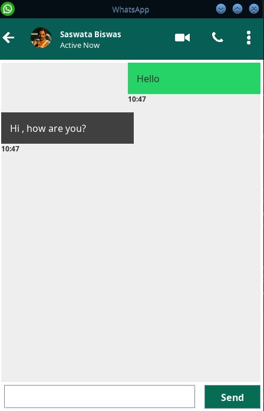
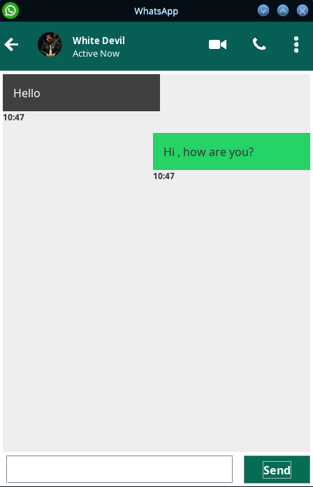

# WhatsAApp Desktop Clone (Java Swing & Sockets)

A real-time, peer-to-peer desktop messaging application inspired by WhatsApp. Built with **Java Swing (GUI)** and **Java Sockets (TCP Networking)**, this project demonstrates client-server socket programming and desktop user interface design.

---

## 📸 Screenshots

| Server (`Saswata Biswas`) | Client (`White Devil`) |
| :---: | :---: |
|  |  |

---

## ✨ Features

- **WhatsApp-Inspired UI**:
  - Signature dark green header bar (`#075E54`) and send button (`#076C54`).
  - Custom profile avatars, user names, and `"Active Now"` status indicator.
  - WhatsApp-style chat bubbles:
    - **Sent messages**: WhatsApp light green bubble (`#25D366`), right-aligned.
    - **Received messages**: Dark gray bubble with white text, left-aligned.
  - Automatic timestamp generation (`HH:mm`) for every sent and received message.
  - HTML text wrapping for responsive bubble layout.
- **Bi-Directional Real-Time Messaging**:
  - Full-duplex messaging using Java TCP Sockets (`ServerSocket` and `Socket`).
  - Low-latency stream transmission using `DataInputStream` and `DataOutputStream` (`UTF-8`).
- **Interactive Controls**:
  - Quick-exit back arrow button.
  - Interactive audio and video call buttons with popup dialog alerts.
  - Action listener on the **Send** button for instant message dispatching.

---

## 📁 Project Structure

```text
.
├── .gitignore               # Ignored files (class files, IDE artifacts)
├── README.md                # Project documentation
├── icons/                   # UI assets and icons
│   ├── 3icon.png            # Three-dots menu icon
│   ├── back.png             # Navigation back button
│   ├── icon.png             # Window application icon
│   ├── phone.png            # Voice call icon
│   ├── user1.png            # Server profile avatar
│   ├── user2.png            # Client profile avatar
│   └── video.png            # Video call icon
├── screenshots/             # Application preview images
│   ├── client.png           # Client window preview
│   └── server.png           # Server window preview
└── whatsaapp/               # Java package containing source code
    ├── Client.java          # Client GUI & socket connection logic
    └── Server.java          # Server GUI & socket listening logic
```

---

## 🛠️ Prerequisites

- **Java Development Kit (JDK)**: Version 8 or higher (JDK 11, 17, or 21 recommended).
- **Operating System**: Cross-platform (Windows, macOS, Linux).

Verify your Java installation by running:
```bash
java -version
javac -version
```

---

## 🚀 Getting Started

### 1. Compile the Source Code

From the root project directory, compile both `Server.java` and `Client.java`:

```bash
javac whatsaapp/*.java
```

### 2. Run the Server

Start the Server application first so it can open port `3001` and listen for incoming connections:

```bash
java whatsaapp.Server
```

### 3. Run the Client

Open a second terminal window in the same project root directory and start the Client:

```bash
java whatsaapp.Client
```

> **Note**: Always launch `Server` before launching `Client` so that the client socket can establish an active TCP connection to `127.0.0.1:3001`.

---

## 🌐 Running Across Different Machines (Local Network)

By default, the client connects to `localhost` (`127.0.0.1`):
```java
Socket s = new Socket("127.0.0.1", 3001);
```

To run across two computers on the same local network:
1. Find the local IP address of the machine running the server (e.g., `192.168.1.5` via `ip addr` or `ipconfig`).
2. Update the IP address in [whatsaapp/Client.java](file:///home/saswata/PROGRAMING/java/Whatsaapp/src/whatsaapp/Client.java#L197):
   ```java
   Socket s = new Socket("192.168.1.5", 3001);
   ```
3. Recompile and start the server and client on their respective machines.

---

## 🧠 Technical Highlights

- **AWT & Swing**: Custom components, `BoxLayout`, `BorderLayout`, `EmptyBorder`, and HTML rendering via `JLabel`.
- **Java Networking**:
  - `ServerSocket` binds to port `3001` and blocks on `accept()` until the client connects.
  - Unbuffered UTF string serialization via `DataOutputStream.writeUTF()` and `DataInputStream.readUTF()`.
- **Dynamic Repainting**: Swing container validation (`f.validate()` / `f.repaint()`) ensures newly appended message panels are immediately displayed.

---

## 🔮 Future Improvements

- [ ] Multi-threaded server supporting multiple concurrent clients (group chat rooms).
- [ ] Database or local file persistence for chat history.
- [ ] Voice and video calling via WebRTC or Java Media Framework.
- [ ] End-to-end encryption (AES-256) for secure messaging.
- [ ] Media attachments (images, audio notes, and documents).

---

## 👤 Author

Developed by **Saswata Biswas**.
